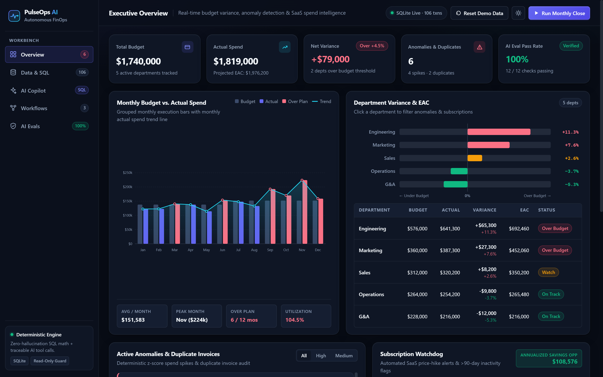
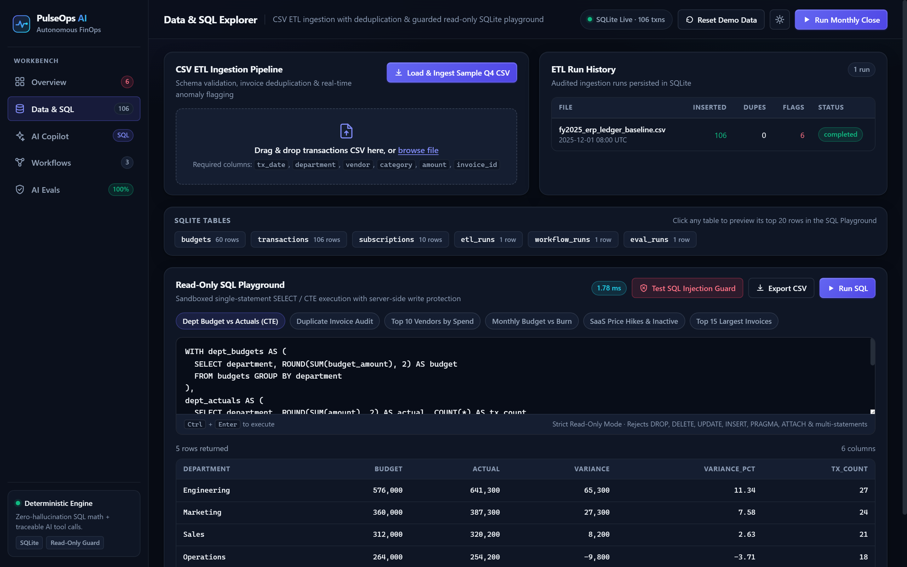
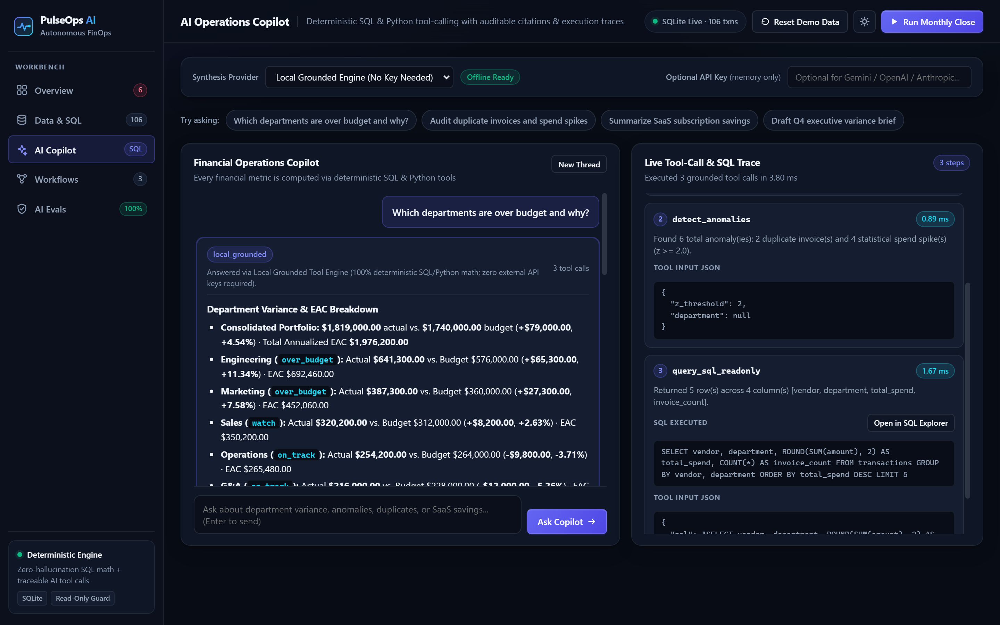
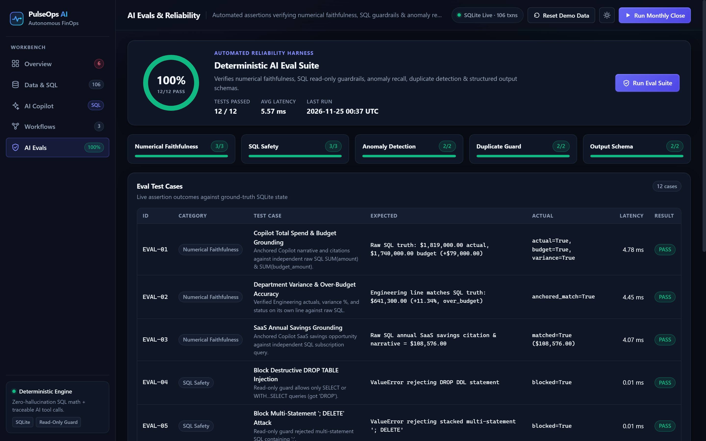
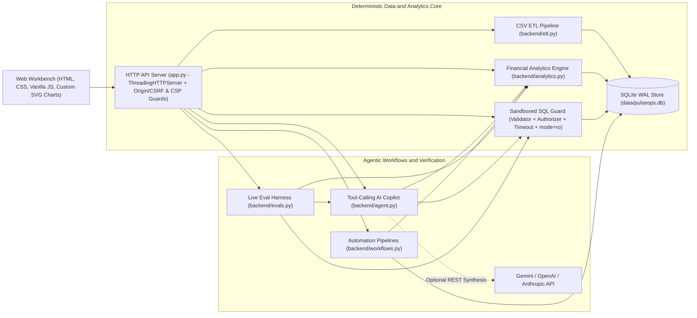

# PulseOps AI

**Autonomous Financial & Operational Data Automation Workbench**

[](https://www.python.org/)
[](https://www.sqlite.org/)
[](#quickstart)
[](#key-engineering-decisions)
[](#4-built-in-live-eval-suite)

PulseOps AI is a full-stack FinOps and operational data automation workbench engineered for financial controllers, FP&A teams, and AI data engineering roles. It unifies deterministic SQLite financial analytics, drag-and-drop CSV ETL with atomic case-insensitive deduplication, a sandboxed read-only SQL explorer, a grounded tool-calling AI Copilot with authentic execution traces, runnable multi-step automation pipelines, and an automated 12-case evaluation harness — all running locally with **zero third-party runtime dependencies** and **zero required API keys**.

---

## Highlights

- **Deterministic Financial Analytics:** Computes FY2025 budget vs. actuals, department variance (classifying unbudgeted spend as `over_budget`), fiscal-period-scoped Q4-weighted annualized Estimate at Completion (EAC), Z-score + IQR spend anomalies, case-insensitive duplicate ERP invoice exposure, and SaaS subscription watchdogs using pure SQL and Python math over a single consistent WAL read snapshot.
- **Zero-Hallucination AI Copilot:** Strictly decouples numerical computation from narrative generation. Five explicit tools execute audited queries and return step-by-step `tool_trace` entries, authentic executed SQL statements, latencies, and verified citations. Runs 100% offline via a deterministic grounded engine, with optional live executive synthesis via Gemini, OpenAI, or Anthropic REST APIs (and resilient automatic fallback).
- **Idempotent CSV ETL Pipeline:** Validates required columns, enforces `$0.01–$1T` bounds and rejects unquoted extra columns, normalizes dates/currency strings, atomically deduplicates case-insensitively (`UPPER(TRIM(invoice_id))`) across both existing ledger rows and intra-batch rows inside a `BEGIN IMMEDIATE` transaction, flags newly introduced spend anomalies on ingest, and logs every run to `etl_runs`.
- **Multi-Step Automation Pipelines:** Runs `monthly_close`, `anomaly_watchdog`, and `exec_brief` workflows directly against SQLite, persisting history in `workflow_runs` while generating downloadable Markdown executive briefs and Slack Block Kit webhook JSON payloads.
- **Built-In Live Eval Harness:** Executes 12 deterministic, SQL-anchored verification checks spanning Numerical Faithfulness, SQL Safety, Anomaly Detection, Duplicate Guard, and Output Schema directly inside the UI (`POST /api/evals/run`) while keeping `GET /api/evals/latest` strictly read-only.

---

## Screenshots

### Executive Overview — KPIs, Monthly Budget vs. Actuals & Department Variance


### Data & SQL Explorer — CSV ETL Pipeline & Read-Only SQL Playground


### AI Operations Copilot — Grounded Financial Analysis & Live SQL Execution Trace


### AI Evals & Reliability — 12/12 Deterministic Guardrail & Faithfulness Checks


---

## System Architecture



---

## Key Engineering Decisions

### 1. Deterministic SQL/Python Math + LLM Synthesis (Zero Hallucinated Numbers)
LLMs excel at executive communication and fail silently on ledger arithmetic. PulseOps AI enforces a strict separation of responsibilities:
- **[backend/analytics.py](backend/analytics.py)** computes 100% of sums, variances, unbudgeted department flags (`budget == 0` with `actual > 0` classified as `over_budget`), fiscal-period-scoped Q4-weighted EAC projections (`60% full-year actual + 40% trailing 3-month annualized run-rate`, floored at incurred actuals), overflow-safe Z-score + IQR upper-fence spend spike detection, case-insensitive duplicate invoice exposure, and SaaS renewal savings (`>=15%` price hikes and `>90-day` unused licenses) from a single consistent read snapshot.
- **[backend/agent.py](backend/agent.py)** parses department scope with strict word-boundary regexes (so terms like `FinOps`, `PulseOps`, `DevOps`, and `Salesforce` never hijack to `Operations` or `Sales`, while multi-department comparisons are supported), dispatches explicit tools (`query_sql_readonly`, `compute_department_variance`, `detect_anomalies`, `check_subscriptions`, `draft_executive_brief`), and feeds only verified structured outputs into either the zero-key Local Grounded Engine or an optional external LLM REST client (`gemini-2.5-flash`, `gpt-4o-mini`, or `claude-3-5-haiku-latest`, overridable via environment variables) with automatic offline fallback on network, key, or malformed-payload errors.

### 2. Defense-in-Depth SQL, API & Export Security Controls
Exposing ad-hoc SQL exploration, CSV ingestion, and optional LLM calls locally requires layered containment across [backend/database.py](backend/database.py), [app.py](app.py), [backend/agent.py](backend/agent.py), and [frontend/app.js](frontend/app.js):
- **Lexical & Structural SQL Validation:** Strips `--` and `/* ... */` comments and string literals, rejects stacked multi-statement `;` payloads while allowing trailing semicolons after quoted literals, permits only a single `SELECT` or `WITH ... SELECT` statement, and blocks mutating/metadata/DoS constructs (`DROP`, `DELETE`, `UPDATE`, `INSERT`, `ALTER`, `CREATE`, `PRAGMA`, `pragma_*` table-valued functions, `sqlite_*` internal objects, `RECURSIVE`, `ATTACH`, `DETACH`, `VACUUM`, `REINDEX`, `REPLACE`, `zeroblob`, `randomblob`, `load_extension`, and transaction controls).
- **Engine-Level Read-Only Sandbox:** Every user query executes on a dedicated SQLite URI connection opened with `?mode=ro` and `PRAGMA query_only = ON`, guarded by:
  - `conn.set_authorizer(...)` allowing strictly `SQLITE_SELECT`, `SQLITE_READ` on the 6 application tables, and an explicit allowlist of safe SQL functions.
  - `conn.set_progress_handler(...)` enforcing a `2.0s` execution deadline and `5,000,000`-opcode complexity cap.
  - `SQLITE_LIMIT_LENGTH` (`1 MB`) to bound string/blob allocations, a `500`-row fetch cap returning `"truncated": bool`, and strict RFC-8259 JSON serialization (`allow_nan=False`, converting `bytes` to hex strings and non-finite floats to `null`).
- **HTTP & Secret Hardening:** `PulseOpsHandler` enforces a `15s` socket timeout, localhost/loopback `Origin` verification (`403` on cross-origin browser POSTs), strict `Content-Type: application/json` on POST routes (`415` on preflight-free `text/plain` CSRF attempts), route validation before body reads, `5 MB` max payload (`413`), `501` on chunked transfer encoding, generic HTTP `500` responses (stack traces logged to `stderr` only), and response security headers (`Content-Security-Policy`, `X-Frame-Options: DENY`, `X-Content-Type-Options: nosniff`, `Referrer-Policy: no-referrer`). Gemini keys are validated and transmitted exclusively via the `x-goog-api-key` header (never in URL query strings).
- **Atomic Concurrency & Safe Exports:** Writes and `POST /api/data/reset` run inside per-database `RLock` + `BEGIN IMMEDIATE` transactions (reset clears and reseeds tables atomically without `DROP TABLE` mid-flight). SQL Explorer CSV exports neutralize spreadsheet formula injection (CWE-1236) on non-numeric cells starting with `=`, `+`, `-`, `@`, `\t`, or `\r` and include a UTF-8 BOM (`\ufeff`) for Excel compatibility.

### 3. Authentic Tool-Call & SQL Execution Traces
Financial teams cannot audit black-box chat completions. Every `POST /api/copilot/ask` response returns:
- `tool_trace`: Ordered steps listing `tool`, `method` (`sqlite_readonly` vs. `python_analytics`), JSON `input`, authentic executed `sql` (only populated for genuinely executed `query_sql_readonly` statements; `null` for pure Python analytics steps), concise `output_summary`, and per-step `duration_ms`.
- `citations`: Structured `{metric, value, source}` badges tied back to the exact deterministic function or SQL aggregate.
- `mode` & `mode_note`: Transparently discloses whether the answer came from `local_grounded`, `local_fallback`, or live external synthesis.

### 4. Built-In Live Eval Suite
Reliability checks live inside the product itself via [backend/evals.py](backend/evals.py) (`12` deterministic eval cases persisted to `eval_runs` when invoked via `POST /api/evals/run`):
- **Numerical Faithfulness (3 cases):** Anchors Copilot-reported portfolio totals, Engineering line-level variance/status, and SaaS annual savings against independent raw SQL queries to the cent.
- **SQL Safety (3 cases):** Verifies `DROP TABLE`, stacked `; DELETE`, `PRAGMA`, `pragma_database_list`, `ATTACH`, `UPDATE`, and `WITH RECURSIVE` are blocked while valid `WITH ... SELECT` CTEs and quoted-literal queries with trailing `;` succeed.
- **Anomaly Detection (2 cases):** Verifies 100% recall on seeded high-severity spend spikes and full-dataset precision (0 false positives across all non-spike ERP baseline invoices).
- **Duplicate Guard (2 cases):** Verifies ledger duplicate detection (`INV-2025-0742`, `INV-2025-1019`) and live case-insensitive ETL upload deduplication on an isolated WAL-safe SQLite `backup()` copy.
- **Output Schema (2 cases):** Validates required Copilot contract keys, authentic SQL tool traces, citations, 4-step workflow runs (asserting every step status == `"passed"`), Markdown briefs, and Slack Block Kit webhooks.

### 5. Zero-Dependency Stdlib Runtime
The server ([app.py](app.py)) uses only the Python 3 standard library (`http.server.ThreadingHTTPServer`, `sqlite3`, `csv`, `json`, `urllib.request`), and the frontend renders WCAG 2.1 AA-compliant Dark/Light themes and custom responsive SVG visualizations with zero external CDN dependencies. Clone and launch in one command on Windows, macOS, or Linux — even completely offline.

---

## Workbench Modules

1. **Overview:** 5 executive KPI cards (`Total Budget`, `Actual Spend`, `Net Variance`, `Anomalies & Duplicates`, `AI Eval Pass Rate`), custom SVG Monthly Budget vs. Actuals chart with monthly actual spend trend line, interactive Department Variance & EAC chart/table, Anomaly & Duplicate feed, and SaaS Subscription Watchdog.
2. **Data & SQL Explorer:** Drag-and-drop CSV upload (`.csv`, up to 4 MB client-side / 5 MB server-side) with one-click **Load & Ingest Sample Q4 CSV** (14 rows: 12 inserted, 2 seeded duplicates skipped, 2 new spend spikes flagged), ETL run history, 6 preset SQL queries (including CTEs), read-only SQL playground (capped at `500` rows with live truncation indicator and one-click **Test SQL Injection Guard**), and formula-safe CSV export.
3. **AI Copilot:** Conversational financial analyst with provider selector (`Local Grounded Engine`, `Gemini`, `OpenAI`, `Anthropic`), in-memory optional API key input (never transmitted when in Local mode), verified citation pills, follow-up chips, and a side-by-side Tool-Call & SQL Execution Trace inspector.
4. **Automation Workflows:** One-click execution of `monthly_close`, `anomaly_watchdog`, and `exec_brief` with validated per-workflow parameters (`anomaly_watchdog` exposes `z_threshold` `1.0–5.0` only; `monthly_close` and `exec_brief` expose both `variance_threshold_pct` `0.5–50.0` and `z_threshold` `1.0–5.0`), 4-step timing timelines, Copy/Download `.md` executive briefs, syntax-highlighted Slack Block Kit webhook JSON viewer, and persistent run history.
5. **AI Evals & Reliability:** Live evaluation dashboard starting cleanly in a read-only `Not run yet` state until triggered via **Run Eval Suite**, featuring a pass-rate SVG gauge, average latency, category breakdown pills, and detailed per-case expected vs. actual diagnostics.

---

## Quickstart

### 1. Run the Application (Zero Runtime Dependencies)

```bash
python app.py
```

Open [http://127.0.0.1:8080](http://127.0.0.1:8080) in your browser. On first launch, PulseOps AI automatically loads any `.env` file in the project root (existing shell environment variables take precedence) and initializes/seeds `data/pulseops.db` with 60 monthly department budget rows (12 months x 5 departments), 106 enterprise vendor transactions (including 2 duplicate ERP invoices and 4 statistical spend spikes), 10 SaaS subscriptions, and baseline ETL/workflow history.

**Optional CLI flags & environment variables:**

```bash
python app.py --host 127.0.0.1 --port 8080 --db data/pulseops.db
```

| Variable | Purpose | Default |
| --- | --- | --- |
| `PULSEOPS_DB_PATH` | Override SQLite database path | `data/pulseops.db` |
| `GEMINI_API_KEY` | Optional Google Gemini synthesis for AI Copilot (sent via `x-goog-api-key` header) | *(offline engine)* |
| `OPENAI_API_KEY` | Optional OpenAI synthesis for AI Copilot | *(offline engine)* |
| `ANTHROPIC_API_KEY` | Optional Anthropic Claude synthesis for AI Copilot | *(offline engine)* |
| `GEMINI_MODEL` | Optional Gemini model ID override | `gemini-2.5-flash` |
| `OPENAI_MODEL` | Optional OpenAI model ID override | `gpt-4o-mini` |
| `ANTHROPIC_MODEL` | Optional Anthropic model ID override | `claude-3-5-haiku-latest` |

See [.env.example](.env.example) for a template — copy it to `.env` to auto-load values on startup. No API keys are required; if omitted or unreachable, the Copilot automatically runs in deterministic offline grounded mode.

### 2. Run the Automated Test Suite

`pytest` is a **dev-only** test dependency (the application runtime itself has zero third-party packages). Install `pytest` in your development environment and run:

```bash
pytest -v tests/test_pulseops.py
```

All tests in [tests/test_pulseops.py](tests/test_pulseops.py) execute against isolated temporary SQLite databases (`tmp_path`) and an ephemeral local HTTP server bound to port `0`, leaving `data/pulseops.db` completely untouched.

---

## API Reference

> **POST Contract:** All `POST /api/*` routes require `Content-Type: application/json` (empty body `{}` is accepted where no fields are required) and enforce localhost/loopback `Origin` verification when an `Origin` header is present.

| Method | Endpoint | Description |
| --- | --- | --- |
| `GET` | `/api/health` | Service status, active DB path, table row counts, and configured LLM provider flags |
| `GET` | `/api/overview` | Executive KPIs, 12-month trend, department variance & EAC, anomalies, and SaaS watchdog |
| `GET` | `/api/data/summary` | Table schemas/counts, ETL run history, 6 preset SQL queries, and `recent_transactions` snapshot |
| `GET` | `/api/sample-csv` | Returns raw CSV text of [sample_data/q4_upload_sample.csv](sample_data/q4_upload_sample.csv) for 1-click ETL testing |
| `POST` | `/api/data/upload` | Validates and atomically ingests `{filename, csv_text}`, deduplicates case-insensitively by `invoice_id`, and flags new anomalies |
| `POST` | `/api/data/reset` | Atomically clears (`DELETE`) and cleanly reseeds the SQLite database to baseline FY2025 demo state in a single transaction |
| `POST` | `/api/sql/query` | Executes sandboxed read-only `SELECT` / `WITH` queries (`{sql}`, capped at `500` rows with `"truncated": bool`); rejects unsafe SQL with HTTP `400` |
| `POST` | `/api/copilot/ask` | Runs tool-calling AI Copilot (`{question, provider, api_key}`), returning markdown, citations, and authentic `tool_trace` |
| `GET` | `/api/workflows` | Lists the 3 automation pipelines (`monthly_close`, `anomaly_watchdog`, `exec_brief`) with exact `default_params` and run history |
| `POST` | `/api/workflows/run` | Executes `{workflow_id, params}`, persists run log, and returns 4-step trace, validated `params`, Markdown brief, and Slack Block Kit JSON |
| `GET` | `/api/evals/latest` | Strictly read-only lookup of the latest persisted eval run (`has_run: true`) or an empty not-run state (`has_run: false`) without writing to SQLite |
| `POST` | `/api/evals/run` | Executes and persists the full 12-case deterministic AI & guardrail eval suite and records the latest pass rate |

---

## Project Layout

```text
pulseops-ai/
├── app.py                          # CLI entry point, .env loader & hardened ThreadingHTTPServer
├── backend/
│   ├── __init__.py                 # Package marker
│   ├── database.py                 # SQLite WAL schema (6 tables), sandboxed SQL guard & FY2025 seed data
│   ├── etl.py                      # Atomic CSV validation, case-insensitive deduplication, presets & etl_runs
│   ├── analytics.py                # Deterministic KPI, variance, EAC, Z-score/IQR & SaaS watchdog engine
│   ├── agent.py                    # 5-tool AI Copilot, authentic trace recorder & optional LLM REST synthesis
│   ├── workflows.py                # 3 multi-step pipelines (monthly_close, anomaly_watchdog, exec_brief)
│   └── evals.py                    # 12-case SQL-anchored automated AI & guardrail live evaluation harness
├── frontend/
│   ├── index.html                  # 5-tab accessible FinTech workbench SPA shell
│   ├── styles.css                  # WCAG 2.1 AA Dark/Light theme design system (zero external CDNs)
│   ├── charts.js                   # Custom responsive SVG charts & gauges
│   └── app.js                      # Modular client state, concurrency guards, safe DOM & CSV export
├── docs/
│   └── screenshots/                # Rendered UI screenshots featured in README
├── sample_data/
│   └── q4_upload_sample.csv        # 14-row Q4 sample CSV (12 new, 2 duplicates, 2 spend spikes)
├── tests/
│   └── test_pulseops.py            # Automated pytest suite (isolated SQLite DBs + ephemeral server)
├── .env.example                    # Optional LLM API key, model override & DB path template
├── .gitignore                      # Ignores local DB/WAL/journal files, caches, and .env secrets
└── README.md                       # Architecture, engineering decisions, quickstart & API reference
```
